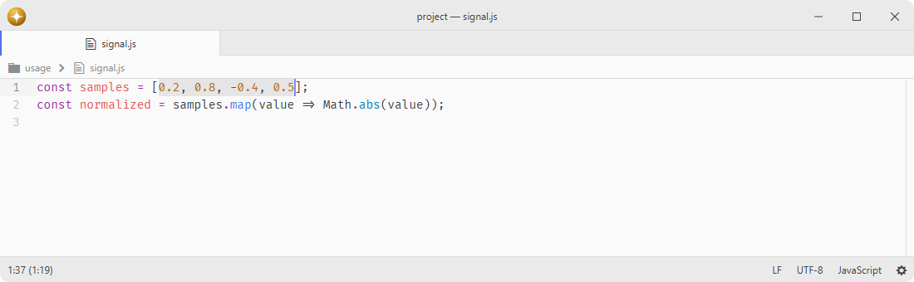

# bracket-matcher

Highlights and jumps between matching brackets, and autocompletes brackets and quotes.

Fork of [pulsar-edit/pulsar](https://github.com/pulsar-edit/pulsar) (`packages/bracket-matcher`).

## Features

- **Bracket highlighting**: highlights the bracket matching the `(){}[]` character under the cursor.
- **Tag matching**: highlights matching XML and HTML tags.
- **Autocompletion**: inserts the closing bracket or quote when an opening one is typed.
- **Selection wrapping**: wraps selected text in brackets or quotes when the opening character is typed.
- **Scoped pairs**: customizes matching pairs globally or per language.
- **Universal editors**: matches brackets in every registered text editor, including docks and panels.
- **Scrollbar markers**: shows the matching bracket positions on the scrollbar and minimap via the marker hub.



## Installation

To install `bracket-matcher` search for it in the Install pane of the Lumine settings, or run the command `lumine --install lumine-code/bracket-matcher`.

## Commands

Commands available in `lumine-text-editor:not([mini])`:

- `bracket-matcher:go-to-matching-bracket`: move the cursor to the matching bracket,
- `bracket-matcher:go-to-enclosing-bracket`: move the cursor to the nearest enclosing bracket,
- `bracket-matcher:select-inside-brackets`: select the text inside the current brackets,
- `bracket-matcher:select-matching-brackets`: select both matching brackets.

Commands available in `lumine-text-editor:not([mini]):not([readonly])`:

- `bracket-matcher:remove-matching-brackets`: remove both matching brackets,
- `bracket-matcher:remove-brackets-from-selection`: remove the brackets surrounding the selection,
- `bracket-matcher:close-tag`: close the current XML/HTML tag.

## Usage

Closing tags scans immutable source chunks and can be cancelled by editing, moving the selection, changing grammar or closing the editor. It does not copy the whole document. HTML tag comparisons ignore case and recognize void elements; XML comparisons retain case. Comments, CDATA and HTML script/style bodies are tokenized rather than interpreted as tag text.

The command declines ambiguous contexts, including a cursor inside unfinished markup, mismatched closing tags or omitted end tags whose scope would require HTML tree construction. This is deliberately more conservative than the former regular-expression fallback. Individual tag names are limited to4096 UTF-16 units, closing-tag tokens to65536 units, and the open-tag stack to16384 names or1 Mi total name units; exceeding a limit reports an error without inserting anything. Attributes and document text are streamed without a whole-document size cap.

## Configuration

Matching pairs can be customized per language through scoped settings in your `config.json`, overriding the package defaults. Changes take effect immediately. For example:

```json
{
  ".rust.source": {
    "bracket-matcher": {
      "autocompleteCharacters": ["()", "[]", "{}", "<>", "\"\"", "``"]
    }
  }
}
```

## Services

- [`bracket-matcher`](docs/bracket-matcher.md): provided to expose the current match — `getMatchRanges(editor)` returns the highlighted bracket pair's buffer ranges, and `observe(callback)` reports every match change, enabling consumers such as scrollbar maps to display bracket positions.
- `marker.layer`: provided to draw matching bracket positions on the editor's overview maps (scrollbar, minimap).

## Contributing

Got ideas to make this package better, found a bug, or want to help add new features? Just drop your thoughts on GitHub. Any feedback is welcome!
